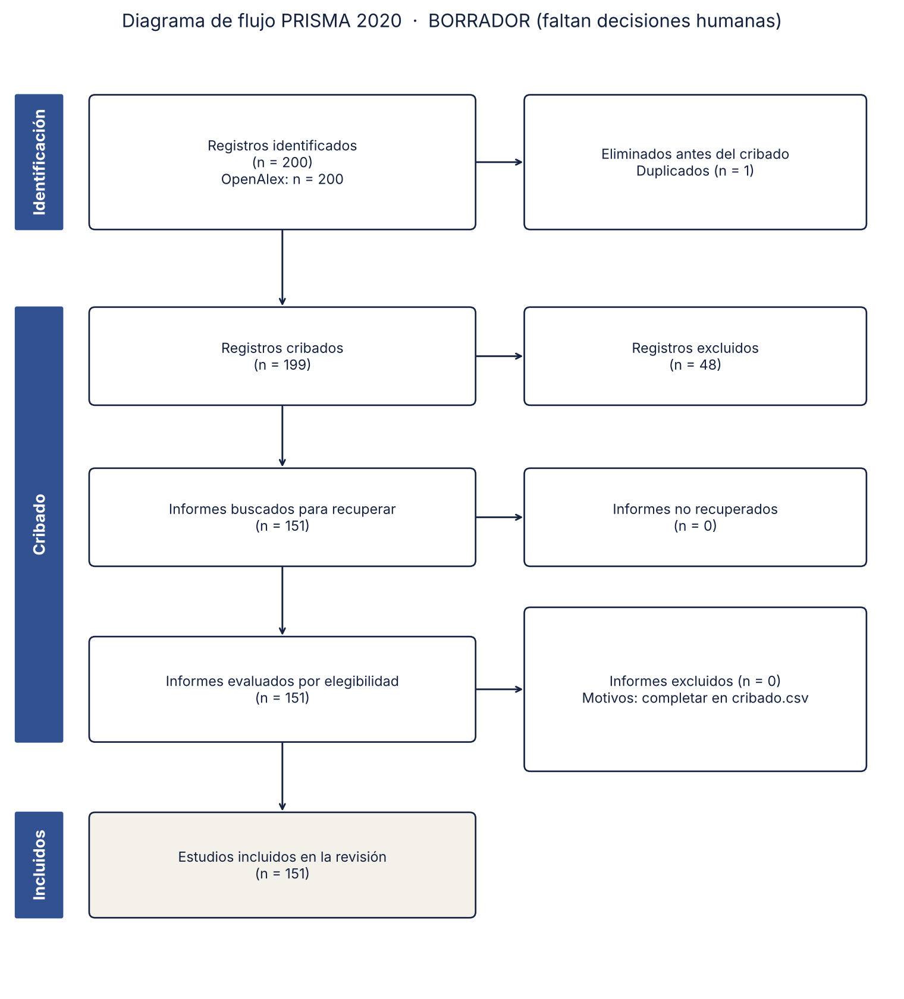

# Revisión sistemática PRISMA con OpenAlex y agentes de IA

Ejemplo reproducible para el **Seminario de Investigación del Doctorado en Ingeniería** (Utadeo), sesión *La IA en la investigación*.

El repositorio lleva una revisión sistemática de punta a punta: búsqueda en **OpenAlex**, unión con exportaciones de **Scopus** o **Web of Science** de la biblioteca, deduplicación, hoja de cribado, **diagrama PRISMA 2020** y un panorama bibliométrico. Incluye un **servidor MCP** para que Claude Code, Codex u otro agente consulte la literatura con datos reales, sin inventar referencias.

> Tema de ejemplo: *aprendizaje automático para pronosticar la demanda de carga de vehículos eléctricos*. Cámbielo en `protocolo.yaml` por el de su tesis.



## 1. Clonar e instalar

```bash
git clone https://github.com/jorgeiv500/revision-prisma-openalex.git
cd revision-prisma-openalex
python -m venv .venv
source .venv/bin/activate        # Windows: .venv\Scripts\activate
pip install -r requirements.txt
cp .env.example .env             # y complete su correo y su clave de OpenAlex
```

**Clave de OpenAlex.** Desde 2026, OpenAlex pide una clave gratuita para tener un presupuesto diario propio. Sin ella, toda la red de la universidad comparte un cupo mínimo y la búsqueda se corta. Pídala en <https://openalex.org/settings/api> y péguela en `OPENALEX_API_KEY`.

## 2. La tubería

| Paso | Comando | Qué produce |
|---|---|---|
| 0. Protocolo | edite `protocolo.yaml` | pregunta, consulta, años, criterios |
| 1. Búsqueda | `python scripts/01_buscar.py` | `datos/crudo/openalex.jsonl` y `registro_busqueda.md` (fecha, filtro, total) |
| 2. Deduplicación | `python scripts/02_deduplicar.py` | `datos/registros.csv` (une OpenAlex, Scopus y WoS) |
| 3. Cribado | `python scripts/03_cribado.py` | `datos/cribado.csv` con sugerencia y columnas para la decisión humana |
| 4. PRISMA | `python scripts/04_prisma.py` | `resultados/prisma_2020.png` y `.svg` |
| 5. Panorama | `python scripts/05_bibliometria.py` | gráficas por año, revistas y los más citados |

O todo de una vez: `./ejecutar_todo.sh`.

**Bases de la biblioteca.** Exporte desde Scopus en CSV (con resumen) o desde Web of Science en "Tab delimited", guarde los archivos en `datos/crudo/` como `scopus_*.csv` o `wos_*.txt`, y vuelva a correr el paso 2.

**Cribado asistido por IA (opcional).** `python scripts/03_cribado.py --ia 50` pide a un modelo una sugerencia para los primeros 50 registros y lo anota en `datos/uso_ia.log`. La sugerencia solo ordena el trabajo. **Deciden dos personas** en `decision_R1` y `decision_R2`, y el consenso va en `decision_final`.

## 3. Trabajar con un agente

El archivo `CLAUDE.md` (copiado como `AGENTS.md` para Codex) fija las reglas: no inventar referencias, no decidir inclusiones, registrar cada búsqueda y cada uso de IA.

### Claude Code
```bash
claude            # dentro de la carpeta; el archivo .mcp.json activa el servidor OpenAlex
```
Pruebe: *"Usa contar_por_anio para ver si el tema crece y propón dos variantes de la consulta del protocolo."*

### OpenAI Codex
Agregue a `~/.codex/config.toml`:
```toml
[mcp_servers.openalex]
command = "python"
args = ["mcp_openalex/server.py"]
env = { OPENALEX_EMAIL = "su_correo@utadeo.edu.co", OPENALEX_API_KEY = "su_clave" }
```

Herramientas del servidor MCP:
- `buscar_trabajos(consulta, anio_desde, anio_hasta, n, orden)`
- `obtener_trabajo(doi_o_id)`, con resumen
- `contar_por_anio(consulta)`

## 4. Qué hay de ejemplo

Las carpetas `datos/` y `resultados/` traen una corrida del 20 de octubre de 2026. OpenAlex informó **1.407 registros**; sin clave se descargaron 200, así que es una **búsqueda incompleta y un diagrama en borrador**, útiles solo para ver los formatos. Corra de nuevo con su clave para obtener la búsqueda completa.

## 5. Antes de publicar

- Registre el protocolo (OSF o PROSPERO) **antes** del cribado.
- Revise `docs/checklist_prisma2020.md` y anote los cambios en `docs/desviaciones.md`.
- Declare el uso de IA con `docs/declaracion_uso_ia.md`.
- Cite PRISMA 2020: Page, M. J., et al. (2021). *BMJ*, 372, n71. https://doi.org/10.1136/bmj.n71
- Cite OpenAlex: Priem, J., Piwowar, H., y Orr, R. (2022). *arXiv:2205.01833*.

## Licencia

Código con licencia MIT. Los metadatos de OpenAlex tienen licencia CC0.

---
Jorge Iván Romero Gélvez, PhD · Universidad de Bogotá Jorge Tadeo Lozano · ORCID [0000-0002-5335-0819](https://orcid.org/0000-0002-5335-0819)
